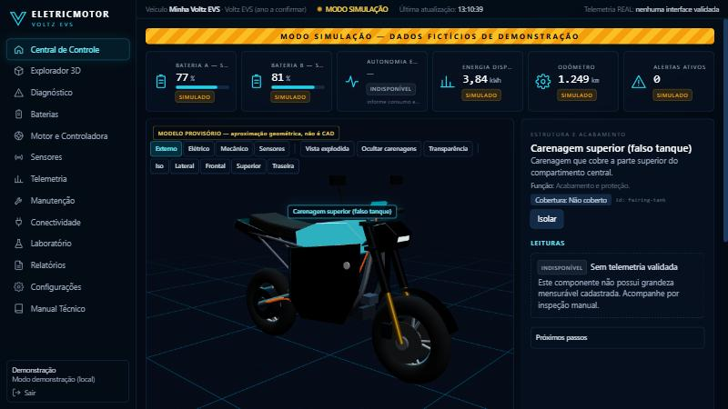
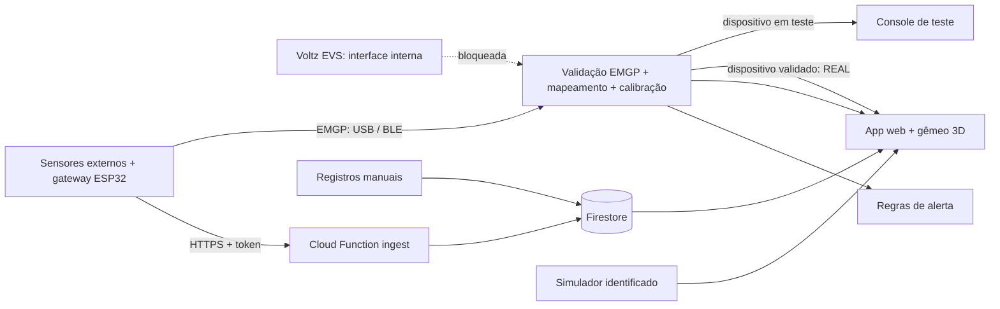

<div align="center">

# ⚡ EletricMotor

**Gêmeo digital para engenharia, diagnóstico e monitoramento de motocicletas elétricas**
Veículo inicial: **Voltz EVS**




</div>

---

## O que é

Uma aplicação web que transforma a moto em um **modelo 3D navegável**, onde cada peça é clicável e abre sua ficha
técnica, as leituras disponíveis, o histórico de manutenção e os próximos passos de instrumentação.

O projeto tem um princípio inegociável: **honestidade dos dados**. Toda informação na tela diz de onde veio:

| Origem              | Significado                                                                 |
| ------------------- | --------------------------------------------------------------------------- |
| 🟢 **REAL**         | Obtido de interface/sensor comprovadamente conectado                        |
| 🔵 **ESTIMADO**     | Derivado de fórmula documentada e entradas identificadas                    |
| 🟠 **SIMULADO**     | Gerado pelo simulador — dado fictício de demonstração                       |
| ⚪ **INDISPONÍVEL** | Não coletado, não validado ou sem sensor — **nunca exibe número inventado** |

> **Componente cadastrado ≠ componente monitorado.** Hoje nenhuma interface eletrônica da EVS foi validada,
> então a cobertura de medição direta é **0%** — e o app mostra isso.

## Destaques

- 🏍️ **Explorador 3D** — rotação 360°, zoom, enquadramentos (iso, lateral, frontal, superior, traseira), seleção por clique/árvore/busca, **vista explodida animada**, ocultar carenagens, transparência, isolamento de conjuntos e modos **Externo / Elétrico / Mecânico / Sensores**. Fallback 2D quando não há WebGL.
- 📊 **Central de Controle** — 3D no centro, árvore de peças, painel contextual e faixa de KPIs (bateria A/B, autonomia, energia, odômetro, alertas) sempre com origem e frescor (**DESATUALIZADO**).
- 🔋 **Baterias A/B independentes** — cadastro de etiqueta, comparação, SOC × SOH × capacidade efetiva com metodologia, leituras manuais e sessões de carga.
- 🧪 **Laboratório** — simulador com 8 cenários (estacionada, carga, urbano, subida, baixa carga com perda de dados, temperatura elevada, falha de BMS, gateway desconectado), play/pause/reset e aceleração do tempo.
- 🚨 **Diagnóstico** — regras de alerta configuráveis (severidade, início/fim, confirmação, sugestão de inspeção) e registro de sintomas. Sem diagnóstico definitivo sem evidência.
- 🛠️ **Manutenção** — serviços, peças, custos, inspeções manuais **com fotos** e lembretes por km/data (rotulados como regra operacional).
- 📡 **Conexão real com sensores externos** — protocolo próprio **EMGP v1** e adaptadores **USB serial**, **Bluetooth (UART/NUS)**, **Bluetooth padrão ESS** e **Internet** (Cloud Function `ingest` com token por dispositivo). Cadastro de dispositivos com mapeamento canal → componente, calibração, **console de teste** e **validação por checklist** — só dispositivos validados geram dados REAIS.
- 📱 **APK Android** — o mesmo app com Bluetooth LE e **USB serial (OTG) nativos**, exportação pelo compartilhamento do Android. Veja [docs/android.md](docs/android.md).
- 🎙️ **Captura e diagnóstico** — gravador de sessão com tudo o que é recebido (bytes brutos, linhas, mensagens, rejeições, mapa GATT), **explorador Bluetooth somente leitura** e registro de erros do app, exportáveis para análise e melhorias.
- 🔧 **Firmware de referência** — ESP32 + DS18B20 (temperatura externa do motor hub) em `firmware/esp32-gateway`.
- 🧭 **Sensores** — inventário de instrumentação proposta (TPMS, temperatura do hub, vibração, GPS, IMU, umidade, medidor de tomada) com riscos e validações pendentes.
- 📘 **Manual Técnico** — integração em 9 passos com critérios de segurança, matriz de evidências e matriz de cobertura.
- 📤 **Relatórios** — **relatório técnico em PDF** (folha A4 com filtro de período e fotos), exportações CSV com unidades, UTC e origem, e **trilha de auditoria** de todas as alterações.

## Começando

**Requisitos:** Node.js 20+ e npm.

```bash
git clone https://github.com/recalchi/EletricMotor.git
```

```bash
cd EletricMotor
```

```bash
npm install
```

```bash
npm run dev
```

Abra **http://localhost:5173** e clique em **“Entrar em modo demonstração”** — nenhum cadastro é necessário.
Depois vá em **Laboratório → Iniciar simulação** para ver o painel ganhar vida.

### Com Firebase (login e dados na nuvem)

1. Copie `.env.example` para `.env.local` e preencha com a configuração **web** do Firebase Console
   (_Configurações do projeto → Seus apps_). Nunca coloque service account ou chaves administrativas.
2. No Firebase Console:
   - **Authentication → Sign-in method**: habilite _E-mail/senha_ e _Google_;
   - **Firestore Database**: crie o banco;
   - publique as regras: `npx firebase-tools deploy --only firestore:rules,storage`.
3. Reinicie `npm run dev` e entre com e-mail ou Google.

Sem `.env.local`, o app funciona normalmente em modo demonstração (dados no `localStorage`).

## Scripts

| Comando                           | Descrição                                                                                            |
| --------------------------------- | ---------------------------------------------------------------------------------------------------- |
| `npm run dev`                     | Servidor de desenvolvimento (Vite)                                                                   |
| `npm run build`                   | Type-check + build de produção em `dist/`                                                            |
| `npm run preview`                 | Serve o build localmente                                                                             |
| `npm test`                        | Testes unitários (Vitest)                                                                            |
| `npm run e2e`                     | Smoke test ponta a ponta (Playwright — rode `npx playwright install chromium` antes)                 |
| `npm run lint` / `npm run format` | ESLint / Prettier                                                                                    |
| `npm run apk`                     | Gera `apk/EletricMotor-debug.apk` (JDK/SDK em `D:\DevTools`, ver [docs/android.md](docs/android.md)) |

## Arquitetura



A interface interna da moto (BMS/controladora) segue bloqueada até haver documentação. A leitura real hoje vem de **sensores externos** do proprietário.

```
src/
  domain/         regras puras: catálogo da EVS, origem do dado, estimativas, cobertura, alertas, sensores
  integrations/   TelemetryAdapter, protocolo EMGP, adaptadores USB/BLE/nuvem, simulador, CSV
  data/           Firebase + repositórios (local para demo, Firestore por usuário)
  app/            sessão, store, rotas, layout
  features/       telas (dashboard, vehicle-3d, batteries, diagnostics, maintenance, …)
  shared/ui/      design system (badges de origem, leituras, cards, gráficos)
functions/        Cloud Function `ingest` (HTTPS, token por dispositivo, agregação por minuto)
firmware/         gateway ESP32 de referência (EMGP)
docs/             arquitetura, matriz de evidências, manual de integração, plano de testes, plano do modelo 3D
firestore.rules   acesso somente do dono; cliente não pode gravar origem REAL
```

Detalhes em [docs/architecture](docs/architecture/README.md).

## Segurança

- Integrações começam **somente leitura**: o contrato de adaptador não tem métodos de escrita/comando.
- Nenhum protocolo, pinagem, código de falha ou medição foi inventado. CAN/UART/BLE/OBD **não são presumidos**.
- Proibido no escopo do projeto: escrita em BMS/controladora, bypass de proteções, abertura de bateria, intervenções em freios sem procedimento aprovado.
- Firestore: cada usuário acessa só os próprios dados; telemetria de alta frequência não é gravada indiscriminadamente.

## Status e limitações

| Item                                                                                      | Status                                                                                                                    |
| ----------------------------------------------------------------------------------------- | ------------------------------------------------------------------------------------------------------------------------- |
| Aplicação, login, 12 telas, simulador, alertas, manutenção com fotos, PDF, CSV, auditoria | ✅ funcional                                                                                                              |
| Modelo 3D                                                                                 | ⚠️ aproximação geométrica **provisória**, sinalizada na tela — [plano do modelo definitivo](docs/3d-model-acquisition.md) |
| Especificações da EVS (72 V / 33,6 Ah, 3 kW…)                                             | ⚠️ hipóteses — há conflitos entre referências ([matriz de evidências](docs/vehicle-evidence/evidence-matrix.md))          |
| Leitura real por sensores externos (USB, BLE, HTTPS)                                      | ✅ funcional — [protocolo EMGP](docs/integration-manual/gateway-protocol.md)                                              |
| Leitura do BMS/controladora da EVS                                                        | ⏳ depende de documentação da interface ([manual de integração](docs/integration-manual/README.md))                       |
| Cloud Function de ingestão                                                                | ✅ código pronto — implantação exige plano Blaze (ou emulador local)                                                      |

## Roadmap

1. ✅ Fundação: projeto, Firebase, autenticação, rotas, design system
2. ✅ Domínio, dashboard e simulador
3. ✅ 3D navegável (modelo provisório)
4. ✅ Diagnóstico e manutenção — relatório PDF, fotos (Storage) e auditoria
5. ✅ Conectividade real — sensores externos, EMGP, USB/BLE/HTTPS, validação de dispositivos (interface interna da EVS ainda bloqueada)
6. ⏳ Validação, revisão de fontes e deploy (Firebase Hosting)

---

<sub>Projeto pessoal de estudo de motores e estruturas de veículos elétricos. Não afiliado à Voltz. As imagens de referência
usadas no design são conceituais e não substituem manuais, medições ou documentação do fabricante.</sub>
