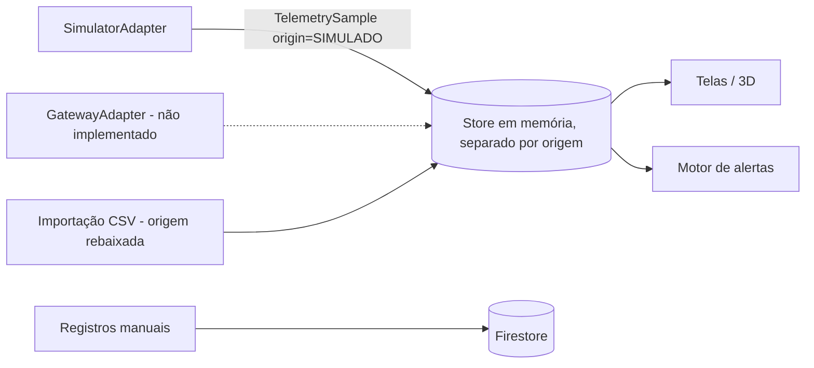

# Arquitetura

## Decisão: Vite + React (SPA)
- Aplicação 100% cliente; não há necessidade de SSR/SEO.
- Deploy direto em **Firebase Hosting** (`dist/` + rewrite para `index.html`).
- Lógica sensível (ingestão de dados REAL) ficará em **Cloud Functions**, nunca no cliente.

## Camadas
```
src/domain        Regras puras (sem React/Firebase): tipos, catálogo, origem, estimativas, cobertura, alertas, sensores
src/integrations  Contrato TelemetryAdapter + simulador + gateway (stub) + CSV
src/data          Firebase (config web) e repositórios: LocalRepository (demo) / FirestoreRepository
src/app           Sessão, store (Zustand), roteamento, layout, ligação adaptadores → store
src/features/*    Telas
src/shared/ui     Componentes visuais (OriginBadge, Reading, Card, gráficos, ícones)
```

## Fluxo de telemetria


- `latest` e `history` são indexados por **origem** — SIMULADO e REAL nunca se misturam.
- Amostra `invalida` não substitui a última válida; ela envelhece e aparece como **DESATUALIZADO**.
- Telemetria de alta frequência **não** é gravada no Firestore (custo). Planejado: agregação por janelas via função de ingestão.

## Modelo Firestore
```
users/{uid}/vehicles/{vehicleId}                      perfil do veículo
users/{uid}/vehicles/{vehicleId}/meta/{batteries|settings}
users/{uid}/vehicles/{vehicleId}/maintenance/{id}
users/{uid}/vehicles/{vehicleId}/inspections/{id}
users/{uid}/vehicles/{vehicleId}/chargingSessions/{id}
users/{uid}/vehicles/{vehicleId}/batteryReadings/{id}
users/{uid}/vehicles/{vehicleId}/symptoms/{id}
users/{uid}/vehicles/{vehicleId}/auditLog/{id}           trilha de auditoria (criar/atualizar/excluir)
```

Fotos: Firebase Storage em `users/{uid}/vehicles/{vehicleId}/photos/{id}.jpg` (redimensionadas para ≤1280 px no
navegador; regras limitam a imagens < 10 MB do próprio usuário). No modo demonstração, miniaturas ≤640 px ficam no
`localStorage`.
Regras (`firestore.rules`): somente o dono (uid) lê/escreve; o cliente não pode gravar `origin == 'REAL'`; limite de campos por documento.

## Próximas fases
- Cloud Function de ingestão autenticada (dispositivo → normalização → agregados).
- `telemetryAggregates` com retenção configurável.
- Fotos também em evidências da matriz técnica.
